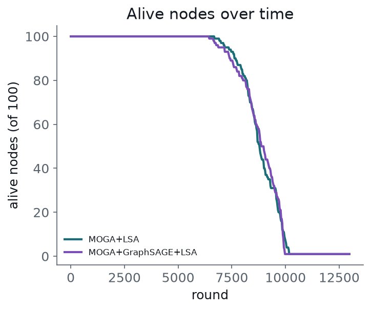

# MOGA+LSA vs. GraphSAGE-Enhanced MOGA+LSA

Cluster-head selection and routing for wireless sensor networks, implemented on a real
sensor dataset, comparing the stock protocol against a variant in which a GraphSAGE
graph embedding replaces the intra-cluster distance term of the fitness function.

This is one track of a wider comparative study on whether graph embeddings improve
cluster-head selection across different WSN clustering algorithms. **The result here is
a null result** — the embedding produced no statistically significant benefit — and the
README explains why that is a useful finding rather than a failed experiment.

---

## 1. What this implements

Two conditions, identical in every respect except one:

| | Cluster-head selection | Routing | Intra-cluster distance measured by |
|---|---|---|---|
| **Baseline** | MOGA (genetic algorithm) | LSA | Euclidean distance between node positions |
| **Enhanced** | MOGA (genetic algorithm) | LSA | Euclidean distance between 16-dim GraphSAGE embeddings |

The genetic operators, population size, generation count, the other two fitness terms,
the LSA routing stage and the energy model are byte-for-byte identical between the two,
so any difference in results is attributable to the embedding substitution alone.

### The per-round pipeline

```
 ┌───────────────────────────────────────────────────────────────────────┐
 │                                                                       │
 │   Sensor        MOGA            LSA           Radio model      Log    │
 │   network  ──►  picks ~10  ──►  picks    ──►  deducts     ──►  metrics│
 │   100 nodes     cluster         routes        TX/RX energy            │
 │                 heads           CH → sink     (dead nodes drop out)   │
 │                                                                       │
 └──────────────────────────── repeat every round ◄──────────────────────┘
```

**MOGA** (Multi-Objective Genetic Algorithm) minimises a scalarised three-term fitness:

```
F = min( ΣΣ D_ij  +  Σ DS_i  −  Σ E_res_i )
```

where `D_ij` is the member-to-cluster-head distance, `DS_i` the cluster-head-to-sink
distance, and `E_res_i` the residual energy of the cluster head (subtracted, since more
energy is better). All three terms are min-max normalised before summation. Note this is
a weighted sum, not a true Pareto method — no non-dominated frontier is maintained.

The GA uses a population of 20 chromosomes (each chromosome = one proposed set of ~10
cluster heads) evolved over 10 generations with elitist truncation selection (top 50%
retained), single-point crossover with duplicate removal and padding, and a 20% mutation
rate. Selection is re-run **every round**, so cluster headship rotates as batteries drain.

**LSA** (Lightning Search Algorithm) then optimises cluster-head-to-sink routing over 30
iterations with a population of 15, minimising a combined objective of end-to-end delay,
transmission energy and delivery ratio. Each cluster head either transmits directly to the
sink or relays through another cluster head.

**Energy** follows the first-order radio model:

```
E_TX(k,d) = k·E_elec + k·E_fs·d²    if d ≤ d₀
E_TX(k,d) = k·E_elec + k·E_mp·d⁴    if d >  d₀
E_RX(k)   = k·E_elec
```

with `E_elec` = 50 nJ/bit, `E_fs` = 10 pJ/bit/m², `E_mp` = 0.0013 pJ/bit/m⁴,
`d₀` ≈ 87.7 m, and a data-aggregation cost `E_da` = 5 nJ/bit paid by cluster heads.
Sensed-data packets are 512 bits; cluster-head messages are 1024 bits.

### The GraphSAGE variant

A 2-layer GraphSAGE encoder (mean aggregation) learns a 16-number embedding per node,
trained once at round 0 and then frozen for the whole run.

| Parameter | Value |
|---|---|
| Encoder | 2 × `SAGEConv`, mean aggregation, ReLU after layer 1 |
| Input / hidden / output dims | 14 → 32 → 16 |
| Neighbour graph | k-NN, k = 8, **Euclidean on node positions** |
| Objective | Unsupervised link prediction (no labels) |
| Loss | `−log σ(pos_score) − log σ(−neg_score)` |
| Score | Dot product of two node embeddings |
| Negative samples | Random pairs, count = number of edges |
| Optimiser / LR / epochs | Adam / 0.01 / 100 (full-batch) |
| Seed | 0 |
| Training frequency | Once at round 0, then frozen |

The 14 input features per node are: normalised X, normalised Y, residual-energy ratio,
and the eleven min-max normalised dataset sensor columns (`Residual_Energy`,
`Transmission_Power`, `Signal_Strength`, `Noise_Level`, `Energy_Consumption`,
`Packet_Loss_Rate`, `Network_Lifetime`, `Adaptive_Learning_Rate`, `Temperature`,
`Humidity`, `Detection_Accuracy`).

> Note the neighbour graph is built from **physical distance**, not from feature
> similarity. The 14 features are what the encoder reads per node; they do not decide
> which nodes are connected.

---

## 2. Setup

```bash
python -m venv .venv
source .venv/bin/activate
pip install -r requirements.txt
```

The dataset is the [Kaggle Wireless Sensor Network Dataset](https://www.kaggle.com/datasets/ziya07/wireless-sensor-network-dataset).
Download `WSN_Dataset.csv` and point the code at it:

```bash
export WSN_DATASET_CSV=/path/to/WSN_Dataset.csv
```

If unset, it falls back to the path baked into `wsn_sim/wsn_dataset.py`, which will only
work on the original machine.

---

## 3. Running it

All scripts are run from the repository root.

```bash
# 3 seeds x 3,000 rounds   → multi_seed_wsn_dataset_results.json   (~10 min)
python run_compare.py

# 1 seed x 13,000 rounds   → wsn_dataset_extended_lifetime.json    (~25 min)
python run_extended_lifetime.py
```

Both result JSONs are already committed, so the plotting scripts below work immediately
without re-running the simulations.

```bash
python presentation_plots.py          # alive / residual / FND-HND bar charts
python throughput_plot.py             # throughput over time
python presentation_single_plots.py   # single-method versions of the curves
python wsn_dataset_all_metrics_plot.py
python wsn_dataset_verdict_plot.py
```

Figures and tables used in the write-up:

```bash
python params_table.py            # simulation + GA parameter table
python graphsage_params_table.py  # GraphSAGE training config table
python fitness_terms.py           # fitness equation with term definitions
python radio_energy_terms.py      # radio energy equations with term definitions
python journal_formulas.py        # equation-only images for the manuscript
python pipeline_doc_figs.py       # pipeline diagrams
python make_pipeline_doc.py       # builds MOGA_LSA_pipeline_explained.pdf
```

Scripts write their output to the working directory. Pre-generated copies of everything
live in `results/`.

### ns-3 validation (optional)

`ns3_wsn_sim.py` drives a real [ns-3](https://www.nsnam.org/) simulation through its
cppyy Python bindings — 802.11b ad-hoc WiFi with `BasicEnergySource` and
`WifiRadioEnergyModel` — and exports NetAnim XML traces, confirming that the selected
cluster heads and LSA relay topology are realisable as an actual packet-level network.
It requires ns-3 built with `--enable-python-bindings` and a trimmed module set:

```
--enable-modules="core;network;mobility;wifi;internet;applications;energy;netanim;point-to-point"
```

**The lifetime and energy results reported below come from the analytical radio model,
not from ns-3.** ns-3 is used for topology validation and visualisation only.

---

## 4. Results

### Short horizon — 3 seeds × 3,000 rounds

No node died in either condition, so the comparison rests on residual energy.

| Metric | MOGA+LSA | MOGA+LSA + GraphSAGE |
|---|---|---|
| Alive at 3,000 rounds | 100 / 100 | 100 / 100 |
| Residual energy (mean ± SD) | 0.33127 ± 0.00039 J | 0.33102 ± 0.00038 J |
| Throughput | 1.0000 | 1.0000 |
| Delivery ratio | 1.0000 | 1.0000 |

The baseline retained marginally more energy in all three seeds, but the mean paired
difference was 0.00025 J — **0.077% of the mean**, against a seed-to-seed standard
deviation of 0.00039 J. A paired t-test gives **t(2) = 2.58, p = 0.123**: not significant.

### Extended horizon — 1 seed × 13,000 rounds

| Metric | MOGA+LSA | MOGA+LSA + GraphSAGE |
|---|---|---|
| FND | 6,700 | 6,450 (−3.7%) |
| HND | 8,800 | 8,875 (+0.9%) |
| LND | not reached | not reached |
| Final throughput | 0.969 | 0.967 |

LND was not reached by either condition within the round budget, with one node still
alive in both. The two reachable milestones move in **opposite** directions, with the
larger movement disfavouring the enhanced condition.

**Conclusion: the embedding substitution produced no measurable benefit.**



The death curves are close to coincident — the clearest single view of the null result.

---

## 5. Why the null result is informative

Two explanations are consistent with the data, and they are **confounded** in this single
experiment — it cannot separate them.

**1. The integration point discards physical meaning.** Transmission energy scales with
`d²` and `d⁴` in *physical* distance. The `D_ij` term is therefore not an arbitrary
proximity heuristic — it is a direct proxy for the energy cost the fitness function is
minimising. Replacing it with a learned distance severs the fitness function from the
energy model, and the structural information gained does not compensate. Integrations
that *add* a guidance term or *re-rank* candidates post-hoc leave the physically grounded
terms intact and let the embedding act as a tie-breaker instead.

**2. The training signal carries no lifetime information.** The unsupervised
link-prediction loss teaches the model to reconstruct the neighbour graph. Nothing in that
objective tells it whether promoting a node as cluster head causes its neighbours to die
sooner — which is exactly the structural property the hypothesis needs it to capture. An
embedding trained only to reconstruct topology can describe the network, but cannot rank
candidates by an outcome it has never observed.

A further wrinkle: because the k-NN graph is built from **physical positions**, the
embedding is partly a re-encoding of geometry the fitness function already had access to,
which limits how much new information it can contribute.

### Known limitations

- Three seeds in the short-horizon run is underpowered for a 0.077% effect.
- Each seed resamples 100 nodes from the same dataset, so deployments share a common
  spatial and feature distribution rather than being independently randomised.
- The sink sits at the centroid of the sampled nodes, so only a **centre-base-station**
  configuration was evaluated.
- LND was never reached, so the tail-lifetime milestone is unmeasured here.
- The null result applies to **this** integration strategy and should not be generalised
  to all possible MOGA + graph-embedding designs.

---

## 6. Repository layout

```
├── wsn_sim/
│   ├── network.py           Radio energy constants, Network state, distance matrix
│   ├── wsn_dataset.py       Loads the Kaggle CSV, samples 100 nodes
│   ├── moga.py              Genetic algorithm: fitness, selection, crossover, mutation
│   ├── lsa.py               Lightning Search Algorithm routing
│   ├── simulate.py          The round loop and metric logging
│   ├── graphsage_embed.py   GraphSAGE encoder and unsupervised training
│   ├── moga_embedding.py    Wires the embeddings into MOGA's fitness
│   └── ns3_export.py        Writes the node roster consumed by ns3_wsn_sim.py
│
├── run_compare.py           3 seeds x 3,000 rounds
├── run_extended_lifetime.py 1 seed x 13,000 rounds, for FND/HND/LND
├── ns3_wsn_sim.py           Real ns-3 run via cppyy, exports NetAnim XML
│
├── *_plot.py, *_plots.py    Result figures
├── *_table.py, *_terms.py   Parameter tables and equation images
├── make_pipeline_doc.py     Builds the explainer PDF
│
├── results/                 Pre-generated figures from the published runs
├── *.json                   Published simulation results
└── MOGA_LSA_pipeline_explained.pdf
```

`MOGA_LSA_pipeline_explained.pdf` is a 6-page plain-language walkthrough of the pipeline
written for teammates who have not read the code.

---

## 7. Implementation notes

- **`ch_selector` interface.** `simulate.run()` calls `ch_selector(network, rng=rng)` and
  expects an array of cluster-head node indices. The baseline passes `moga.select_cluster_heads`
  directly; the enhanced condition passes `moga_embedding.make_selector()`, which closes
  over a trained embedder and forwards it to the same `moga.select_cluster_heads` via its
  `embed_map` argument. This is why the two conditions share one code path.
- **Embeddings are cached.** `graphsage_embed.make_embedder()` trains on its first call
  and returns the cached result thereafter. Node positions and ten of the eleven sensor
  features are static in this dataset, so per-round retraining would cost a great deal
  and change almost nothing.
- **ns-3 energy headroom.** `ns3_export.py` multiplies exported node energy by
  `NS3_ENERGY_HEADROOM = 20.0`. ns-3 draws idle/CCA-busy current continuously and would
  otherwise deplete the dataset's small real energies (~0.3–0.8 J) mid-animation. This
  affects the **visualisation only** and never the reported metrics.
- **Radio constants.** The source paper publishes its Table 1 parameters as unfilled
  placeholders, so the standard Heinzelman et al. (LEACH lineage) values are used instead
  and documented in `wsn_sim/network.py`.

---

## 8. References

[1] W. Tan and F. Wang, "Cluster based WSN routing with MOGA and LSA optimization,"
*Scientific Reports*, vol. 16, no. 1, Art. no. 9953, 2026,
doi: [10.1038/s41598-026-35584-5](https://doi.org/10.1038/s41598-026-35584-5)

[2] W. L. Hamilton, R. Ying, and J. Leskovec, "Inductive Representation Learning on Large
Graphs," *NeurIPS*, 2017.

[3] W. B. Heinzelman, A. P. Chandrakasan, and H. Balakrishnan, "An application-specific
protocol architecture for wireless microsensor networks," *IEEE Trans. Wireless
Communications*, vol. 1, no. 4, pp. 660–670, 2002.

[4] Ziya07, "Wireless Sensor Network Dataset," Kaggle.
https://www.kaggle.com/datasets/ziya07/wireless-sensor-network-dataset
