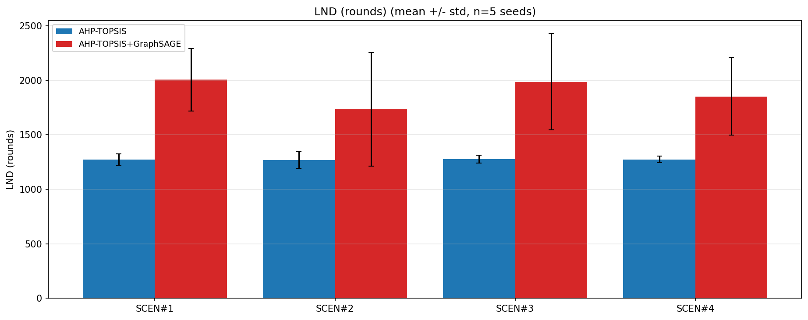
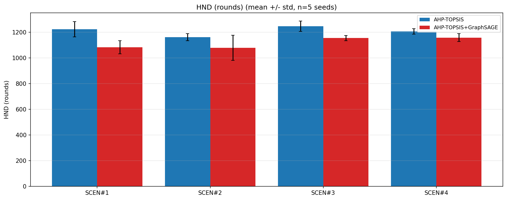

# OCHSAT with and without GraphSAGE

Python simulation of **OCHSAT**, a cluster head (CH) selection protocol for wireless sensor networks that uses K-Means clustering and AHP-TOPSIS. The code also tests a **GraphSAGE extension**: GraphSAGE re-ranks the top AHP-TOPSIS candidates, and OCHSAT is compared with and without it.

## Reference

The OCHSAT protocol follows:

> A. Al-Qurabat et al., "Optimizing cluster heads for energy efficiency in WSNs using MADM approaches," *Telecommunication Systems*, vol. 89, Art. 26, 2026.

## How it works

AHP-TOPSIS ranks the nodes in each cluster on residual energy, centrality and distance to the base station. The AHP weights are fixed by a pairwise matrix. The top-ranked node becomes CH.

**With GraphSAGE:** AHP-TOPSIS selects its top 5 candidates and a frozen GraphSAGE model re-ranks them using the radio-range graph of the cluster.

## Setup

| Item | Value |
|---|---|
| Field | 100 m x 100 m, uniform random nodes |
| Scenarios | SCEN#1: 100 nodes, BS centre; SCEN#2: 100 nodes, BS corner; SCEN#3: 200 nodes, BS centre; SCEN#4: 200 nodes, BS corner |
| Test seeds | 42, 101, 202, 303, 404 |
| Maximum rounds | 2500 |

## Results

Mean over 5 seeds, in rounds (`results/summary.json`).

| Scenario | Method | FND | HND | LND |
|---|---|---|---|---|
| SCEN#1 | OCHSAT | 740.0 | 1223.0 | 1273.2 |
| | OCHSAT + GraphSAGE | 624.8 | 1083.4 | 2005.0 |
| SCEN#2 | OCHSAT | 713.6 | 1160.4 | 1270.0 |
| | OCHSAT + GraphSAGE | 565.8 | 1078.6 | 1732.4 |
| SCEN#3 | OCHSAT | 698.6 | 1246.2 | 1276.8 |
| | OCHSAT + GraphSAGE | 706.4 | 1154.2 | 1987.0 |
| SCEN#4 | OCHSAT | 686.4 | 1205.4 | 1273.4 |
| | OCHSAT + GraphSAGE | 702.6 | 1158.0 | 1851.2 |

LND increases by 36% to 57% with GraphSAGE (significant in 3 of 4 scenarios, p < 0.05). HND decreases in all four scenarios (significant in 2). FND differences are not significant. GraphSAGE therefore extends the tail of the network's life.

More plots are in `results/`

Note: Results depend on the trained checkpoint.